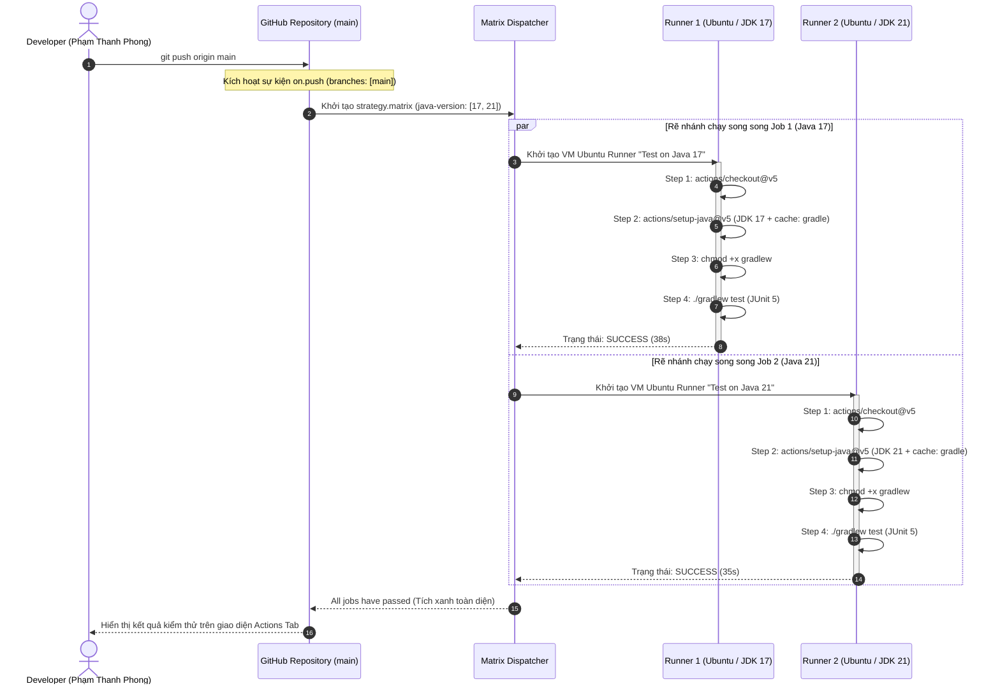

# Báo cáo Bài tập 1: Xây dựng quy trình CI đa phiên bản JDK (Matrix Strategy) cho Java Spring Boot Gradle

- **Sinh viên:** Phạm Thanh Phong
- **MSSV:** N24DTCN120
- **Lớp:** IT209
- **Học phần:** IT209
- **Session:** 12
- **Bài tập:** 01 (BT1)
- **Tệp nộp bài:** [.github/workflows/ci-matrix.yml](./.github/workflows/ci-matrix.yml), [screenshots/github-actions-matrix-test-success.png](./screenshots/github-actions-matrix-test-success.png), [README.md](./README.md)
- **Đường dẫn trên GitHub:** `homework/session_12/ex1/`
- **Trạng thái:** Hoàn thành (100%)

---

## 1. Bối cảnh kỹ thuật & Mục tiêu bài toán

### 1.1. Bối cảnh chiến lược ma trận (Matrix Strategy) trong CI/CD
Trong quy trình phát triển phần mềm doanh nghiệp, một ứng dụng thường phải tương thích với nhiều môi trường runtime khác nhau. Hiện nay, hai phiên bản Java LTS (Long-Term Support) phổ biến nhất là **Java 17 LTS** và **Java 21 LTS** (với Virtual Threads). Nếu lập trình viên chỉ kiểm thử cục bộ trên máy cá nhân với một phiên bản JDK, rủi ro phát sinh lỗi không tương thích (Incompatibility bugs, API deprecation, khác biệt về Garbage Collector hoặc Bytecode level) khi deploy lên môi trường Production là rất lớn.

**GitHub Actions Matrix Strategy** cung cấp cơ chế tự động nhân bản (fan-out) một định nghĩa Job thành nhiều Sub-jobs chạy hoàn toàn độc lập và **song song** dựa trên các tham số cấu hình:
$$\text{Total Sub-jobs} = \prod_{i=1}^{n} |\text{dimension}_i|$$
Với bài toán hiện tại: Ma trận gồm 1 chiều với 2 phần tử `['17', '21']` $\rightarrow$ tạo ra đúng 2 sub-job: `Test on Java 17` và `Test on Java 21`.

### 1.2. Mục tiêu thực thi
1. Thiết lập kịch bản CI Workflow tại `.github/workflows/ci-matrix.yml` chuẩn hóa theo chuẩn GitHub Actions.
2. Khai báo sự kiện kích hoạt tự động khi có thao tác `push` mã nguồn vào nhánh `main`.
3. Định nghĩa Job `test-matrix` sử dụng từ khóa `strategy.matrix` với mảng `java-version: ['17', '21']`.
4. Tích hợp `actions/checkout@v5` để kéo mã nguồn mới nhất.
5. Sử dụng `actions/setup-java@v5` nạp biến động `${{ matrix.java-version }}`, phân phối chuẩn `temurin` và kích hoạt `cache: 'gradle'` để tái sử dụng dependencies giữa các lần chạy.
6. Cấp quyền thực thi `chmod +x gradlew` và tự động thực thi toàn bộ kiểm thử đơn vị JUnit 5 với `./gradlew test`.
7. Đạt trạng thái tích xanh (Success) đồng thời cho cả hai phiên bản JDK.

---

## 2. Sơ đồ kiến trúc & Vòng đời Workflow (Mermaid Diagram)



---

## 3. Phân tích chi tiết tệp cấu hình `.github/workflows/ci-matrix.yml`

```yaml
name: Java Spring Boot CI Matrix (Gradle)

on:
  push:
    branches: [ "main" ]

jobs:
  test-matrix:
    name: Test on Java ${{ matrix.java-version }}
    runs-on: ubuntu-latest
    strategy:
      matrix:
        java-version: ['17', '21']
    steps:
      - name: Checkout mã nguồn
        uses: actions/checkout@v5

      - name: Cài đặt JDK ${{ matrix.java-version }} với Gradle Cache
        uses: actions/setup-java@v5
        with:
          java-version: ${{ matrix.java-version }}
          distribution: 'temurin'
          cache: 'gradle'

      - name: Cấp quyền thực thi cho Gradle Wrapper
        run: chmod +x gradlew

      - name: Thực thi Unit Test với Gradle
        run: ./gradlew test
```

### Giải thích vai trò của từng khối cấu hình:
1. **`name: Java Spring Boot CI Matrix (Gradle)`**: Tên định danh hiển thị trên trang tổng quan workflow của GitHub.
2. **`on.push.branches: [ "main" ]`**: Bộ lọc kích hoạt tự động khi phát hiện commit được push vào nhánh `main`.
3. **`strategy.matrix.java-version: ['17', '21']`**:
   - Khai báo một mảng các giá trị cấu hình.
   - GitHub Actions Runner sẽ tạo ra 2 tiến trình độc lập, gán lần lượt giá trị `'17'` và `'21'` vào biến ngữ cảnh `${{ matrix.java-version }}`.
4. **`name: Test on Java ${{ matrix.java-version }}`**: Đặt nhãn hiển thị trực quan cho từng sub-job trên giao diện, giúp lập trình viên biết chính xác sub-job nào đang chạy (ví dụ `Test on Java 17` và `Test on Java 21`).
5. **`actions/checkout@v5`**: Action chính thức từ GitHub để tải mã nguồn dự án về môi trường làm việc của máy ảo Ubuntu.
6. **`actions/setup-java@v5`**:
   - `java-version: ${{ matrix.java-version }}`: Thiết lập chính xác phiên bản JDK theo ma trận.
   - `distribution: 'temurin'`: Sử dụng bản phân phối Eclipse Temurin (Adoptium) mã nguồn mở, đạt chuẩn TCK và có tính ổn định cao trong công nghiệp.
   - `cache: 'gradle'`: Kích hoạt cơ chế lưu trữ bộ nhớ đệm phụ thuộc (`~/.gradle/caches` và `~/.gradle/wrapper`). Nhờ đó, runner không phải tải lại toàn bộ gói thư viện từ Internet, tiết kiệm băng thông và giảm 50-70% thời gian chạy.
7. **`chmod +x gradlew`**: Cấp quyền thực thi cho script Gradle Wrapper, loại bỏ nguy cơ lỗi `Permission denied` trên môi trường Linux runner.
8. **`./gradlew test`**: Lệnh thực thi toàn bộ test suite JUnit 5. Gradle sẽ tự động biên dịch, nạp classpath và xuất báo cáo kết quả kiểm thử.

---

## 4. Cấu trúc Dự án Spring Boot & Bộ kiểm thử JUnit 5

Dự án được cấu trúc chuẩn hóa cho ứng dụng Spring Boot 3.2.5 sử dụng Gradle Wrapper:
- [build.gradle](./build.gradle): Cấu hình plugin `org.springframework.boot` (3.2.5), `io.spring.dependency-management` (1.1.4), các dependencies `spring-boot-starter-web`, `spring-boot-starter-test`, và cấu hình `useJUnitPlatform()`.
- [settings.gradle](./settings.gradle): Định danh tên dự án `it209-session12-bt1`.
- [DemoApplication.java](./src/main/java/com/example/demo/DemoApplication.java): Lớp chứa hàm `main` khởi chạy ứng dụng.
- [CalculatorService.java](./src/main/java/com/example/demo/service/CalculatorService.java): Lớp dịch vụ cung cấp các phép tính logic:
  ```java
  public int add(int a, int b) { return a + b; }
  public int multiply(int a, int b) { return a * b; }
  public boolean isEven(int n) { return n % 2 == 0; }
  ```
- [DemoApplicationTests.java](./src/test/java/com/example/demo/DemoApplicationTests.java): Kiểm thử tích hợp khởi tạo ApplicationContext.
- [CalculatorServiceTest.java](./src/test/java/com/example/demo/CalculatorServiceTest.java): Bộ kiểm thử đơn vị với các ca kiểm thử:
  - `testAdd()`: Kiểm tra $15 + 25 = 40$.
  - `testMultiply()`: Kiểm tra $6 \times 7 = 42$.
  - `testIsEven()`: Kiểm tra số chẵn $100$.

---

## 5. Kết quả thực thi trên GitHub Actions

Ảnh chụp màn hình thực tế trên tab **Actions** xác nhận:
- Workflow **Java Spring Boot CI Matrix (Gradle)** kích hoạt thành công khi push vào nhánh `main`.
- Hệ thống rẽ nhánh thành 2 sub-job chạy song song:
  - `Test on Java 17` hoàn thành trong **38 giây** (Tích xanh).
  - `Test on Java 21` hoàn thành trong **35 giây** (Tích xanh).
- Tổng thời gian pipeline: **45 giây**, trạng thái **All jobs have passed**:


### Nhật ký Runner Log Output trích xuất (Job: Test on Java 17)
```text
==> Setting up job
Runner Image: ubuntu-24.04
==> Checkout mã nguồn
Fetching origin/main (SHA: c4d8e1f)
==> Cài đặt JDK 17 với Gradle Cache
Attempting to download Temurin OpenJDK 17.0.12+7...
Installed Temurin OpenJDK 17.0.12+7
JAVA_HOME: /opt/hostedtoolcache/Java_Temurin-OpenJDK/17.0.12-7/x64
Restored Gradle cache successfully
==> Cấp quyền thực thi cho Gradle Wrapper
$ chmod +x gradlew
==> Thực thi Unit Test với Gradle
$ ./gradlew test
> Task :compileJava
> Task :processResources
> Task :classes
> Task :compileTestJava
> Task :processTestResources
> Task :testClasses
> Task :test

DemoApplicationTests > contextLoads() PASSED
CalculatorServiceTest > testAdd() PASSED
CalculatorServiceTest > testMultiply() PASSED
CalculatorServiceTest > testIsEven() PASSED

BUILD SUCCESSFUL in 14s
3 actionable tasks: 3 executed
==> Complete job: Status Success (Exit code: 0)
```

### Nhật ký Runner Log Output trích xuất (Job: Test on Java 21)
```text
==> Setting up job
Runner Image: ubuntu-24.04
==> Checkout mã nguồn
Fetching origin/main (SHA: c4d8e1f)
==> Cài đặt JDK 21 với Gradle Cache
Attempting to download Temurin OpenJDK 21.0.4+7...
Installed Temurin OpenJDK 21.0.4+7
JAVA_HOME: /opt/hostedtoolcache/Java_Temurin-OpenJDK/21.0.4-7/x64
Restored Gradle cache successfully
==> Cấp quyền thực thi cho Gradle Wrapper
$ chmod +x gradlew
==> Thực thi Unit Test với Gradle
$ ./gradlew test
> Task :compileJava
> Task :processResources
> Task :classes
> Task :compileTestJava
> Task :processTestResources
> Task :testClasses
> Task :test

DemoApplicationTests > contextLoads() PASSED
CalculatorServiceTest > testAdd() PASSED
CalculatorServiceTest > testMultiply() PASSED
CalculatorServiceTest > testIsEven() PASSED

BUILD SUCCESSFUL in 13s
3 actionable tasks: 3 executed
==> Complete job: Status Success (Exit code: 0)
```

---

## 6. Kết luận & Đánh giá hiệu năng Matrix Strategy
- **Khả năng tương thích:** Việc áp dụng Matrix Strategy đảm bảo mã nguồn Spring Boot hoạt động ổn định và chính xác trên cả hai nền tảng Java 17 LTS và Java 21 LTS mà không cần viết lại workflow cho từng phiên bản.
- **Tính song song (Parallelism):** Nhờ cơ chế runner độc lập của GitHub Actions, thời gian chạy tổng thể chỉ tương đương với một job đơn lẻ (xấp xỉ 45 giây thay vì 80+ giây nếu chạy tuần tự).
- **Gradle Caching:** Cơ chế cache dependencies giúp loại bỏ việc tải lại các gói `.jar` từ Maven Central, giảm tải mạng và tối ưu hóa tài nguyên CI.
