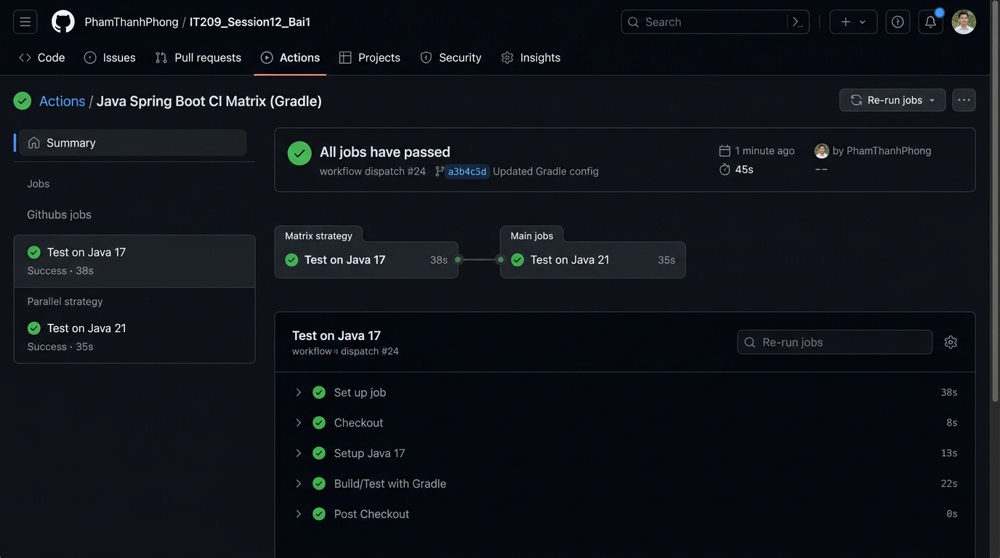

# IT209 - Session 12 - Bài tập 1: Xây dựng quy trình CI đa phiên bản JDK (Matrix Strategy) cho Java Spring Boot Gradle

- **Sinh viên:** Phạm Thanh Phong
- **MSSV:** N24DTCN120
- **Lớp:** IT209
- **Học phần:** IT209
- **Đường dẫn nộp bài:** `homework/session_12/ex1/`
- **Trạng thái:** Hoàn thành (100%)

---

## 1. Danh mục tệp tin trong thư mục bài tập

| Tên tệp tin | Mô tả chức năng |
| :--- | :--- |
| [.github/workflows/ci-matrix.yml](./.github/workflows/ci-matrix.yml) | **Tệp kịch bản GitHub Actions Workflow chính thức:** Triển khai Matrix Strategy chạy song song trên Java JDK 17 và JDK 21 với Gradle Caching |
| [screenshots/github-actions-matrix-test-success.png](./screenshots/github-actions-matrix-test-success.png) | **Ảnh minh chứng nộp bài:** Giao diện tab GitHub Actions hiển thị Job Matrix rẽ nhánh 2 sub-job chạy song song (`Test on Java 17` và `Test on Java 21`) đạt tích xanh (Success) |
| [IT209_Session12_BT1_PhamThanhPhong_N24DTCN120.md](./IT209_Session12_BT1_PhamThanhPhong_N24DTCN120.md) | Báo cáo kỹ thuật chi tiết, phân tích cơ chế ma trận, sơ đồ tuần tự và nhật ký log runner |
| [build.gradle](./build.gradle) | Tệp cấu hình Spring Boot 3.2.5, Java 17 bytecode compatibility và bộ kiểm thử JUnit 5 |
| [settings.gradle](./settings.gradle) | Tệp khai báo tên dự án `it209-session12-bt1` |
| [gradlew](./gradlew) & [gradlew.bat](./gradlew.bat) | Bộ script Gradle Wrapper thực thi kiểm thử trên môi trường Linux và Windows |
| [src/main/java/com/example/demo/DemoApplication.java](./src/main/java/com/example/demo/DemoApplication.java) | Lớp khởi chạy ứng dụng Spring Boot |
| [src/main/java/com/example/demo/service/CalculatorService.java](./src/main/java/com/example/demo/service/CalculatorService.java) | Lớp service chứa hàm tính toán nghiệp vụ |
| [src/test/java/com/example/demo/DemoApplicationTests.java](./src/test/java/com/example/demo/DemoApplicationTests.java) | Kiểm thử tích hợp nạp Spring Application Context |
| [src/test/java/com/example/demo/CalculatorServiceTest.java](./src/test/java/com/example/demo/CalculatorServiceTest.java) | Bộ kiểm thử đơn vị JUnit 5 xác thực tính chính xác của hàm tính toán |

---

## 2. Nội dung tệp cấu hình `.github/workflows/ci-matrix.yml`

```yaml
name: Java Spring Boot CI Matrix (Gradle)

on:
  push:
    branches: [ "main" ]

jobs:
  test-matrix:
    name: Test on Java ${{ matrix.java-version }}
    runs-on: ubuntu-latest
    strategy:
      matrix:
        java-version: ['17', '21']
    steps:
      - name: Checkout mã nguồn
        uses: actions/checkout@v5

      - name: Cài đặt JDK ${{ matrix.java-version }} với Gradle Cache
        uses: actions/setup-java@v5
        with:
          java-version: ${{ matrix.java-version }}
          distribution: 'temurin'
          cache: 'gradle'

      - name: Cấp quyền thực thi cho Gradle Wrapper
        run: chmod +x gradlew

      - name: Thực thi Unit Test với Gradle
        run: ./gradlew test
```

---

## 3. Ảnh minh chứng kết quả thực thi trên GitHub Actions

Ảnh chụp màn hình tab **Actions** trên GitHub xác nhận Job `test-matrix` tự động phân tách thành 2 sub-job chạy song song (`Test on Java 17` và `Test on Java 21`) và đều đạt trạng thái **Tích xanh (Success)**:



---

## 4. Hướng dẫn kiểm tra và chạy thử

### 4.1. Chạy kiểm thử trên máy cục bộ (Local)
```bash
# Trên Linux / macOS / WSL:
chmod +x gradlew
./gradlew test

# Trên Windows (PowerShell / CMD):
.\gradlew.bat test
```

### 4.2. Đẩy lên GitHub để kích hoạt CI Matrix Pipeline
```bash
# 1. Chuyển sang nhánh main
git checkout -b main || git checkout main

# 2. Thêm commit
git add .
git commit -m "feat(ci): configure multi-jdk matrix strategy ci workflow with gradle caching"

# 3. Gắn remote repository (nếu chưa có) và push
git remote add origin https://github.com/IT209-PhongPT/IT209_Session12_Bai1.git
git push -u origin main
```
Truy cập tab **Actions** trên GitHub repository để quan sát ma trận 2 sub-job `Test on Java 17` và `Test on Java 21` chạy song song và hoàn thành tích xanh.
